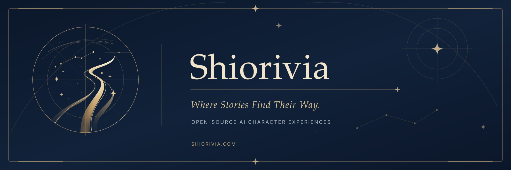

# Shiorivia Cloud — BYOK Preview

**A Serverless, Zero-Config AI Visual Novel Interface.**  
**无需部署、打开即用的沉浸式 AI 互动前端。**

[English](#english) | [中文说明](#中文说明)

---

> [!NOTE]
> **This is the Cloud Demo Version / 这是云端试玩版**  
> ☁️ **Cloud Version**: No installation required. Runs in your browser. Data saved in `localStorage`.  
> 📦 **Full Local Version**: Supports custom Live2D models, local BGM, unlimited storage, and offline mode.  
> **Want the full experience? / 想要加载自定义角色和本地音乐？**  
> 👉 [**Shiorivia Local Edition**](https://github.com/seemoon1/Shiorivia)

---

## 🇬🇧 English

### ✨ What is this?
Shiorivia Cloud is a lightweight browser-based AI chat interface. Your browser connects to the Shiorivia Cloud backend, which forwards BYOK requests to AI providers such as **DeepSeek**, **Google Gemini**, and **OpenRouter**.

*   **Zero Install**: Just open the webpage.
*   **BYOK / privacy boundary**: API keys and chat history may be stored in your browser's `localStorage`. Keys and relevant prompts are sent to this site's server-side proxy for provider requests. The server operator/hosting provider may technically access request data; use only providers and deployments you trust. See [SECURITY.md](SECURITY.md).
*   **Visual Novel Mode**: Write immersive stories with auto-generated illustrations (requires Volcengine/Fal keys).

### 🔑 How to Use (Bring Your Own Key)
To use this app, you need an API Key from an AI provider.

1.  **DeepSeek (Recommended for Speed & Cost)**
    *   Register at [platform.deepseek.com](https://platform.deepseek.com/).
    *   Create an API Key. (Very affordable!)
    *   Click the **Key Icon (🔑)** in the left sidebar of the app and paste it.

2.  **Google Gemini (Free Option)**
    *   Get a free key at [Google AI Studio](https://aistudio.google.com/app/apikey).
    *   Paste it into the "Google Gemini Key" slot.

3.  **Start Chatting!**
    *   Select your model and enjoy.

---

## 🇨🇳 中文说明

### ✨ 这是什么？
Shiorivia Cloud 是一个浏览器即开的 AI 聊天与小说交互前端。它通过 Cloud 服务端代理请求模型提供商，无需在本地部署推理环境。

*   **⚡ 秒开秒玩**: 没有 Python 环境，没有报错。
*   **🔒 BYOK 隐私边界**：密钥与聊天记录可保存在浏览器 `localStorage`，但调用模型时密钥及相关对话会经过本站服务端代理。站长、托管平台及模型提供商均属于不同信任边界；参见 [SECURITY.md](SECURITY.md)。
*   **💸 丰俭由人**: 支持超便宜的国产之光 **DeepSeek-V3**，也支持免费的 **Google Gemini**。

### 🔑 如何开始 (三步走)

本项目采用 **BYOK (自带密钥)** 模式。你需要填入自己的 API Key 才能驱动 AI。

#### 1. 获取密钥 (任选其一)

*   **[推荐] DeepSeek (深度求索)**
    *   国内直连，速度极快，价格极低（几块钱能聊很久）。
    *   注册地址: [platform.deepseek.com](https://platform.deepseek.com/)
    *   注册并充值（5元即可），创建一个 API Key。

*   **[免费] Google Gemini**
    *   每天有免费额度，适合白嫖党。
    *   获取地址: [Google AI Studio](https://aistudio.google.com/app/apikey)

*   **[万能] OpenRouter**
    *   支持 Claude 3.5, GPT-4o 等顶级模型。
    *   注册地址: [openrouter.ai](https://openrouter.ai/)

#### 2. 填入密钥
*   点击网页左侧边栏底部的 **【🔑 Local API Vault】** 按钮。
*   将你申请到的 `sk-xxxx` 密钥填入对应的框中。
*   点击“固化至本地”。

#### 3. 开始创造
*   选择 **Story Mode (故事模式)** 进行角色扮演。
*   选择 **Novel Mode (梦境模式)** 让 AI 帮你写小说。

> **想要生图和视频？**
> 在设置中填入 **火山引擎 (Volcengine)** 或 **Fal.ai** 的密钥，即可在对话中解锁 `<draw>` 和 `<video>` 功能。

---

## ⚖️ License / 协议

Copyright (c) 2026 Tsuki (seemoon1).

Licensed under the **GNU Affero General Public License v3.0 (AGPL-3.0)**.

Commercial use of AGPL-licensed **code** is permitted under the license; commercial use of Shiorivia **official branding** requires separate permission. See [TRADEMARKS.md](TRADEMARKS.md).
遵守 AGPL-3.0 即可依法商用**源码**；使用 Shiorivia **官方品牌标识**进行商业活动须另行取得许可，详见 [品牌政策](TRADEMARKS.md)。
See also [BRANDING.md](BRANDING.md) and [SECURITY.md](SECURITY.md).

---

## 🙏 Acknowledgements / 致谢

*   **Character Data**: 部分角色基础设定参考自 [Moegirl Encyclopedia (萌娘百科)](https://zh.moegirl.org.cn/)，遵循 [CC BY-NC-SA 3.0](https://creativecommons.org/licenses/by-nc-sa/3.0/deed.zh) 协议。

*   **Music / Sound**: Demo music provided by [MaouDamashii (魔王魂)](https://maoudamashii.jokersounds.com/). 
    示例音乐由 魔王魂 提供（或参考其开源精神）。

*   **UI Inspiration**: Inspired by the aesthetics of *BanG Dream! It's MyGO!!!!!*.